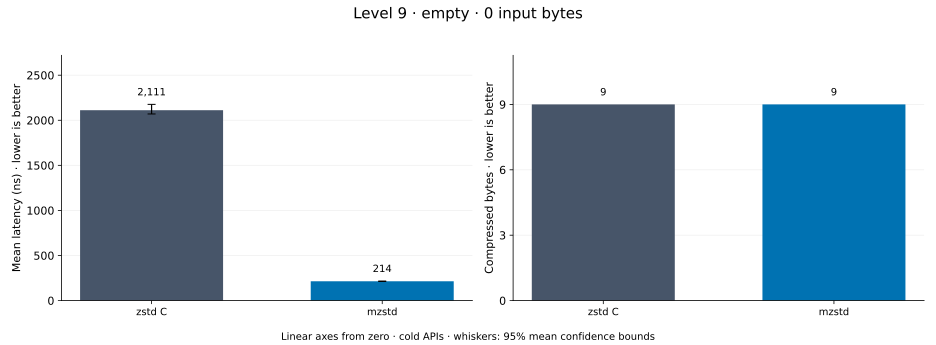
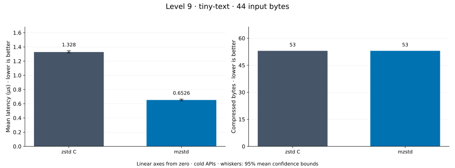
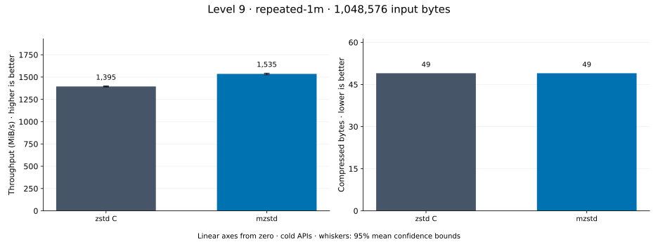
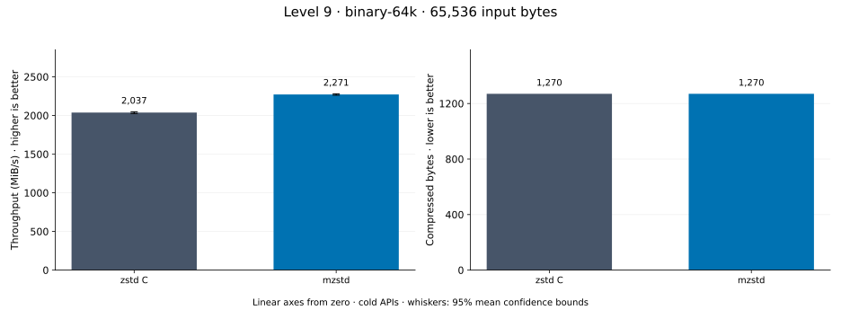
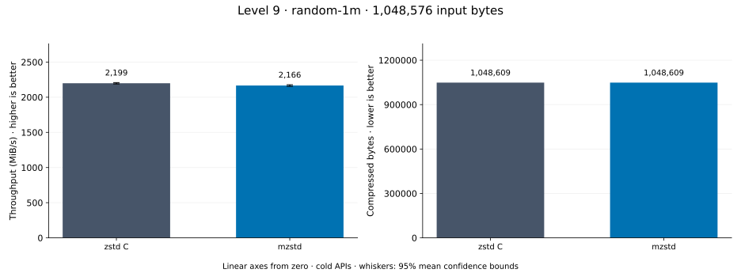
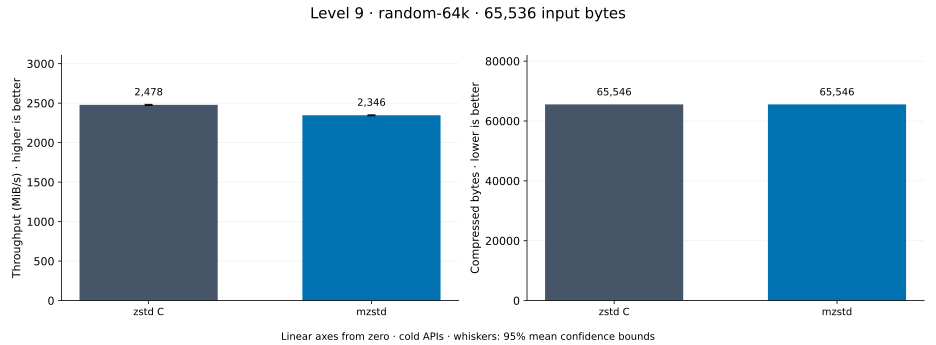
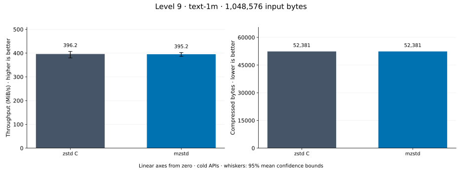
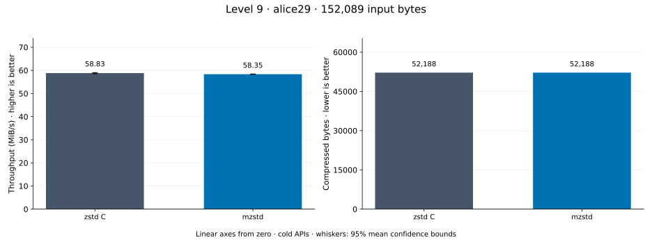

# Compression level 9

[Benchmark index](../README.md) · [Median overview](README.md) · [← Level 8](l8.md) · [Level 10 →](l10.md)

Recorded run: **full-20261030** (2026-10-30).
[Raw results](../encoder-comparison.csv) · [Environment](../encoder-comparison-environment.json) · [Run analysis](../encoder-comparison.md).

## Median across all datasets

Each of the 8 datasets has equal weight, including empty and tiny input.
Speed / C = C mean latency / implementation mean latency; output / C = implementation bytes / C bytes.
We take the median of these 8 per-dataset ratios separately for speed and size.
1× matches C; higher speed and lower output are better. These are medians across datasets,
not median sample latencies, and do not imply statistical significance.

| Implementation | Median speed / C ↑ | Median output / C ↓ | Datasets |
| --- | ---: | ---: | ---: |
| zstd C | 1.000× | 1.000× | 8 |
| mzstd main | 1.316× | 1.000× | 8 |
| mzstd | 1.256× | 1.000× | 8 |

mzstd main is the same matrix measured on `0a4fd87` in a process beside this run's; its ratios use that run's C timings.

Measurement setup and interpretation

zstd 1.5.7 (the C library built by `zstd-ffi`) and mzstd at the recorded
working tree compress identical bytes at this level. Every frame was checked byte-identical
to zstd's and decoded back to its input before any timing.

These are cold native API measurements: construction, allocation, compression, and disposal.
Complete known input; 20 samples, 0.5 s warmup, at least 1 s measurement.
Host: AMD Ryzen 9 7950X, Linux KVM guest with two dedicated vCPUs: the working tree's Criterion process pinned to vCPU 0 and the main branch's to vCPU 1, side by side; nothing else ran. unset; Cargo release defaults (bench profile), runtime SIMD dispatch (AVX-512 level on this host; the decoder runs its block loops at the AVX2 level).

Chart whiskers and table intervals describe 95% confidence bounds on mean timing.
They do not capture all host or allocator variation. Throughput bounds are transformed latency bounds.
Output / input is compressed bytes divided by input bytes; smaller is better, and values above 100% mean expansion.
For empty input, throughput and output / input are undefined (—).
See the [run analysis](../encoder-comparison.md#interpretation-limits) for measurement limitations.

## Dataset details

Ordered by mzstd speed / C, highest first; all 8 datasets are shown.
This order uses recorded mean latency, not statistical significance. Bars start at zero.

[empty](#empty) · [tiny-text](#tiny-text) · [repeated-1m](#repeated-1m) · [binary-64k](#binary-64k) · [random-1m](#random-1m) · [random-64k](#random-64k) · [text-1m](#text-1m) · [alice29](#alice29)

### empty

Empty input; measures API overhead. **Input: 0 bytes.**

mzstd speed / C: **9.867×**; output: 9 / 9 bytes.
mzstd main speed / C: 10.663× (separate run).

Exact measurements and confidence bounds

| Implementation | Mean, ns | 95% mean interval, ns | MiB/s | Output bytes | Output / input | Speed / C |
| --- | ---: | ---: | ---: | ---: | ---: | ---: |
| zstd C | 2,111 | 2,070–2,176 | — | 9 | — | 1.000× |
| mzstd | 214 | 211.1–216.4 | — | 9 | — | 9.867× |

### tiny-text

44-byte quick-brown-fox sentence. **Input: 44 bytes.**

mzstd speed / C: **5.277×**; output: 53 / 53 bytes.
mzstd main speed / C: 5.320× (separate run).

Exact measurements and confidence bounds

| Implementation | Mean, µs | 95% mean interval, µs | MiB/s | Output bytes | Output / input | Speed / C |
| --- | ---: | ---: | ---: | ---: | ---: | ---: |
| zstd C | 2.44 | 2.425–2.454 | 17.20 | 53 | 120.455% | 1.000× |
| mzstd | 0.4623 | 0.4542–0.4742 | 90.76 | 53 | 120.455% | 5.277× |

### repeated-1m

1 MiB of repeated a bytes. **Input: 1,048,576 bytes.**

mzstd speed / C: **2.254×**; output: 49 / 49 bytes.
mzstd main speed / C: 1.956× (separate run).

Exact measurements and confidence bounds

| Implementation | Mean, µs | 95% mean interval, µs | MiB/s | Output bytes | Output / input | Speed / C |
| --- | ---: | ---: | ---: | ---: | ---: | ---: |
| zstd C | 604.7 | 603.5–606.1 | 1,653.59 | 49 | 0.005% | 1.000× |
| mzstd | 268.3 | 268.1–268.6 | 3,726.77 | 49 | 0.005% | 2.254× |

### binary-64k

64 KiB of structured binary bytes: ((i / 16) XOR i) modulo 256. **Input: 65,536 bytes.**

mzstd speed / C: **1.364×**; output: 1,270 / 1,270 bytes.
mzstd main speed / C: 1.406× (separate run).

Exact measurements and confidence bounds

| Implementation | Mean, µs | 95% mean interval, µs | MiB/s | Output bytes | Output / input | Speed / C |
| --- | ---: | ---: | ---: | ---: | ---: | ---: |
| zstd C | 32.33 | 32.31–32.35 | 1,933.44 | 1,270 | 1.938% | 1.000× |
| mzstd | 23.7 | 23.68–23.72 | 2,637.21 | 1,270 | 1.938% | 1.364× |

### random-1m

1 MiB of deterministic xorshift64 pseudorandom bytes. **Input: 1,048,576 bytes.**

mzstd speed / C: **1.148×**; output: 1,048,609 / 1,048,609 bytes.
mzstd main speed / C: 1.120× (separate run).

Exact measurements and confidence bounds

| Implementation | Mean, µs | 95% mean interval, µs | MiB/s | Output bytes | Output / input | Speed / C |
| --- | ---: | ---: | ---: | ---: | ---: | ---: |
| zstd C | 442.4 | 434.1–450.3 | 2,260.43 | 1,048,609 | 100.003% | 1.000× |
| mzstd | 385.5 | 380–391.3 | 2,594.33 | 1,048,609 | 100.003% | 1.148× |

### random-64k

64 KiB prefix of the deterministic pseudorandom corpus. **Input: 65,536 bytes.**

mzstd speed / C: **1.086×**; output: 65,546 / 65,546 bytes.
mzstd main speed / C: 1.226× (separate run).

Exact measurements and confidence bounds

| Implementation | Mean, µs | 95% mean interval, µs | MiB/s | Output bytes | Output / input | Speed / C |
| --- | ---: | ---: | ---: | ---: | ---: | ---: |
| zstd C | 24.15 | 24.11–24.2 | 2,587.58 | 65,546 | 100.015% | 1.000× |
| mzstd | 22.25 | 21.94–22.56 | 2,809.47 | 65,546 | 100.015% | 1.086× |

### text-1m

Alice text repeated cyclically to 1 MiB. **Input: 1,048,576 bytes.**

mzstd speed / C: **1.041×**; output: 52,381 / 52,381 bytes.
mzstd main speed / C: 1.016× (separate run).

Exact measurements and confidence bounds

| Implementation | Mean, µs | 95% mean interval, µs | MiB/s | Output bytes | Output / input | Speed / C |
| --- | ---: | ---: | ---: | ---: | ---: | ---: |
| zstd C | 2,293 | 2,284–2,301 | 436.13 | 52,381 | 4.995% | 1.000× |
| mzstd | 2,202 | 2,198–2,207 | 454.09 | 52,381 | 4.995% | 1.041× |

### alice29

Alice in Wonderland text from the Canterbury corpus (`testdata/alice29.txt`). **Input: 152,089 bytes.**

mzstd speed / C: **0.992×**; output: 52,188 / 52,188 bytes.
mzstd main speed / C: 0.971× (separate run).

Exact measurements and confidence bounds

| Implementation | Mean, µs | 95% mean interval, µs | MiB/s | Output bytes | Output / input | Speed / C |
| --- | ---: | ---: | ---: | ---: | ---: | ---: |
| zstd C | 2,465 | 2,457–2,477 | 58.83 | 52,188 | 34.314% | 1.000× |
| mzstd | 2,486 | 2,482–2,490 | 58.35 | 52,188 | 34.314% | 0.992× |

